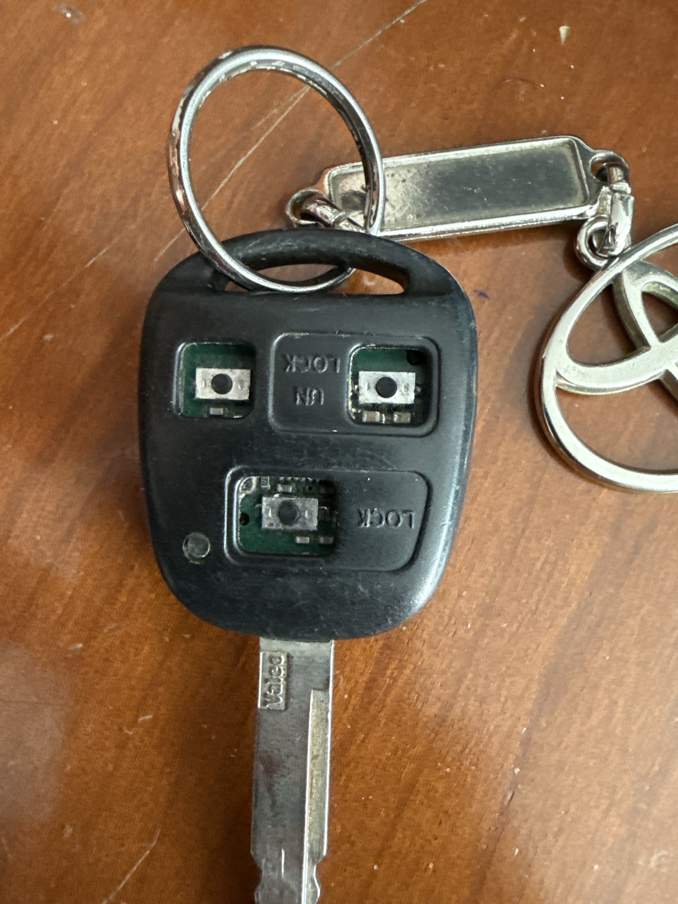
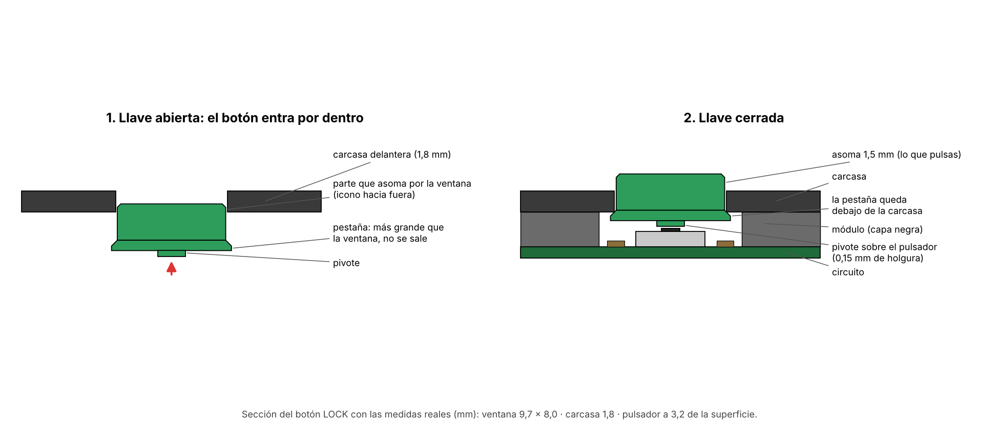
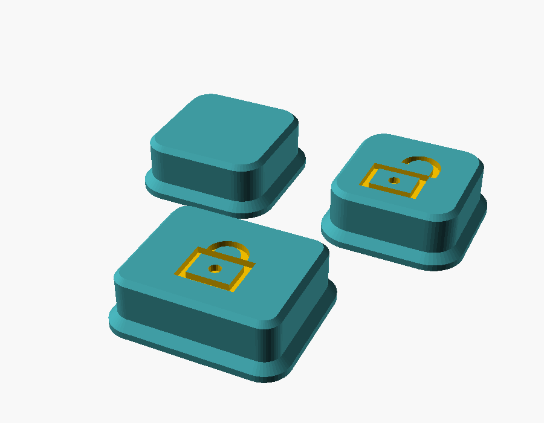
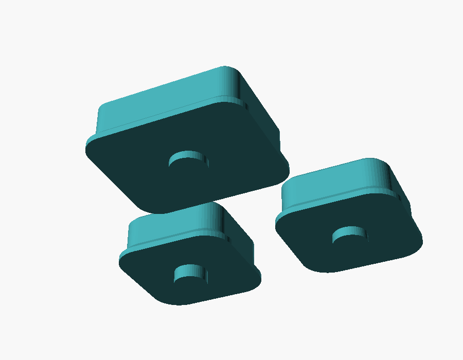

# Botones 3D para el mando Toyota Avensis 2005 (3 botones)

Botones de repuesto imprimibles para la llave **Valeo de 3 botones (hoja TOY43)** del
Toyota Avensis T25 (2003‑2009). La misma carcasa la usan Lexus IS/GS/RX de la época.



Los botones de goma originales se deshacen y dejan las ventanas de la carcasa vacías.
Estos botones sustituyen a los originales: **se meten por dentro de la carcasa**, asoman
por la ventana y una pestaña interior impide que se salgan. Debajo, un pivote aprieta el
micropulsador del módulo.






## Medidas (tomadas con calibre en la llave real)

| Ventana | Ancho × alto | Profundidad hasta el pulsador* |
|---|---|---|
| Arriba‑izquierda | 8,3 × 8,0 | 3,65 |
| UNLOCK (arriba‑derecha) | 8,3 × 8,0 | 3,35 |
| LOCK (abajo) | 9,7 × 8,0 | 3,20 |

\* Desde la superficie exterior de la carcasa, con la llave cerrada.
Grosor de la carcasa en el borde de la ventana: **1,8 mm**. Grosor del módulo: 7,85 mm.

## Archivos

| Archivo | Para qué |
|---|---|
| `3mf/prueba_holgura_3_juegos.3mf` | **Imprimir primero.** 3 juegos completos con holgura 0,10 / 0,15 / 0,22 mm (marcados con 1, 2 y 3 puntos). Te quedas con el que mejor entre. |
| `3mf/prueba_ancho_botones_arriba.3mf` | Si los botones de arriba no entran: 4 anchos (7,9 / 7,6 / 7,3 / 7,0 mm de ventana, 1‑4 puntos) para arriba‑izquierda (fila de arriba) y UNLOCK (fila de abajo). |
| `3mf/avensis_3_botones.3mf` | Un juego de 3 botones con la holgura por defecto (0,15). |
| `3mf/boton_*.3mf` | Botones sueltos. |
| `stl/` | Lo mismo en STL. |
| `scad/avensis_botones.scad` | Modelo paramétrico (OpenSCAD o el *Parametric Model Maker* de MakerWorld). |
| `tools/dibujo_montaje.py` | Genera `img/montaje.png`. |

Al abrir un 3MF, Bambu Studio avisa *"The 3mf file has invalid config, load geometry data only"*:
es normal, pulsa OK y elige impresora, placa, filamento y perfil.

## Imprimir en Bambu Lab P2S, boquilla 0.2 mm

Los botones se imprimen **con la cara del icono contra la cama**: sin soportes (la pestaña
crece a 45°) y con la superficie exterior con la textura de la placa.

| Ajuste en Bambu Studio | Valor |
|---|---|
| Impresora / boquilla | Bambu Lab P2S – 0.2 mm |
| Placa | Textured PEI |
| Perfil de proceso | `0.08mm High Quality @BBL P2S 0.2 nozzle` |
| Material | **ASA** (ideal: aguanta calor y sol) o **PETG**. PLA solo para pruebas |
| Paredes | 3–4 |
| Relleno | 100 % |
| Soportes | No |

> **TPU:** Bambu no recomienda TPU con boquilla 0.2. Para botones blandos, boquilla 0.4 y TPU 95A.

## Montaje

1. Abre la llave (tornillo de atrás) y saca el módulo emisor.
2. Limpia restos de goma vieja con alcohol isopropílico.
3. Con la carcasa delantera boca abajo, mete cada botón **por dentro** en su ventana, con el
   icono hacia fuera. La pestaña queda apoyada por dentro alrededor de la ventana.
4. Vuelve a poner el módulo encima, cierra y atornilla.
5. Prueba: cada botón debe hacer *clic* al pulsarlo y volver solo.

Si alguno:
- **no hace nada:** el pivote no llega → sube su `depth_*` 0,2 mm en el `.scad`.
- **se queda pulsado** o la llave no cierra bien: baja su `depth_*` 0,2 mm.
- **roza en la ventana:** usa el juego con más puntos (más holgura).
- **baila mucho:** usa el juego con menos puntos.

## Exportar desde OpenSCAD

```sh
openscad -o stl/avensis_3_botones.stl       -D 'part="caps"' -D clearance=0.15 scad/avensis_botones.scad
openscad -o stl/prueba_holgura_3_juegos.stl -D 'part="fit"'  scad/avensis_botones.scad
```

Iconos por botón (`icon_tl`, `icon_un`, `icon_lk`): `none`, `lock`, `unlock`, `trunk`, `dot`.

## Referencias

- Goma de repuesto Avensis 2004‑2009 / Lexus (3 botones): https://autonavaimet.fi/en/tuotteet/TRKS27
- Botones Toyota imprimibles (otros mandos): https://www.printables.com/model/593394-toyota-key-fob-spare-buttons
- Carcasa Toyota 3 botones para reutilizar la goma: https://stlfinder.com/model/toyota-key-fob-enclosure-3-button-9OZYcGmd/6544212
